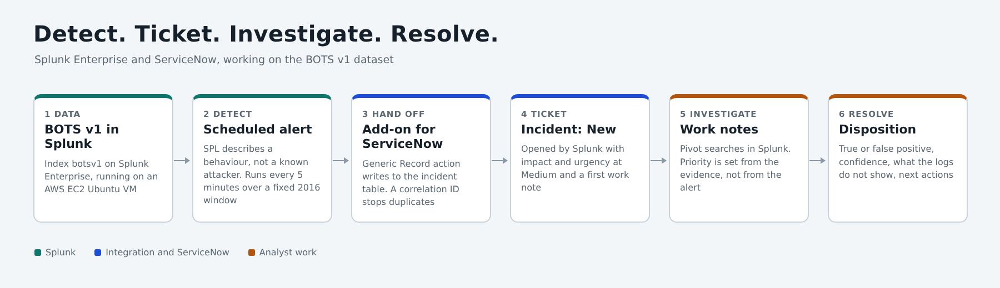
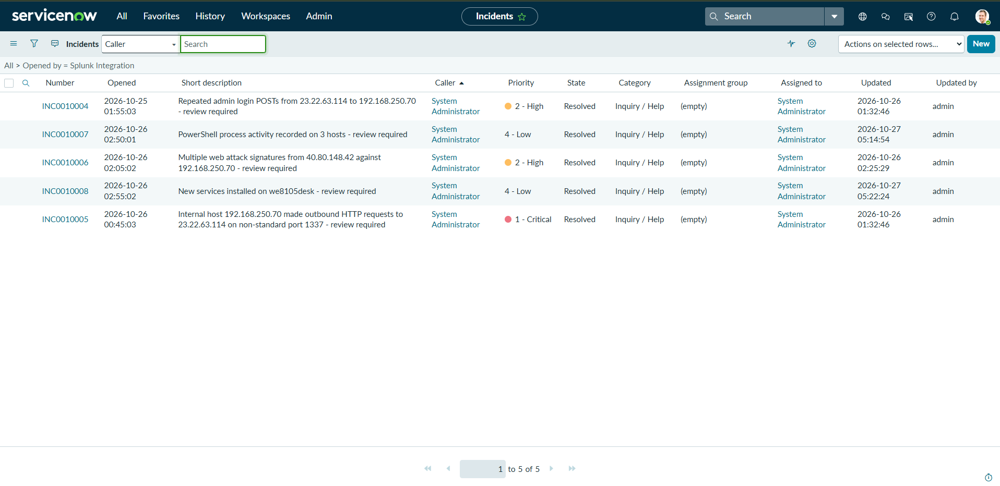

# Splunk SOC Alert Triage and Incident Management

I built a small SOC workflow with Splunk Enterprise and ServiceNow. Scheduled Splunk searches watch the Boss of the SOC (BOTS) v1 dataset and open tickets in ServiceNow's incident table. I then worked each ticket the way an analyst would: validated the alert in Splunk, followed up with more searches, wrote work notes, set the priority from the evidence and resolved it with a disposition.

The result is five tickets. Three are true positives (one Critical and two High) and two are false positives that I closed with an explanation.

## What is in this repo

- `full-writeup.md` is the long version of the project, including the MITRE ATT&CK mapping, also available as `full-writeup.pdf`.
- `spl/` has the five detection searches with their ServiceNow alert action settings, and the searches I used while investigating.
- `images/` holds the evidence. The ServiceNow instance name is covered and no credentials are shown.

## Environment

- Splunk Enterprise on an AWS EC2 Ubuntu VM, opened through an SSH tunnel.
- BOTS v1 data in an index named `botsv1`.
- A free ServiceNow Personal Developer Instance, using the real incident table.
- The Splunk Add-on for ServiceNow, using its Generic Record action to create incidents.

## How it works

1. Each detection is an SPL search that describes a behaviour, such as many admin login POSTs from one source in five minutes. None of them names a known attacker.
2. Each search is saved as a scheduled alert. The data is from August 2016, so every search carries a fixed time window.
3. When an alert fires, the add-on creates an incident with a short description, a description, impact and urgency at Medium, a correlation ID and a first work note. The correlation ID stops repeat runs from creating duplicates.
4. I open the ticket, investigate in Splunk, write work notes, set impact and urgency from the evidence, and resolve it with a disposition, a confidence level and next actions.

## Results

| Ticket | Alert | Priority | Disposition |
|---|---|---|---|
| INC0010004 | Repeated admin login attempts from one source | 2 - High | True positive |
| INC0010005 | Outbound HTTP to a non-standard port from an internal host | 1 - Critical | True positive |
| INC0010006 | Multiple web attack signatures from one source | 2 - High | True positive |
| INC0010007 | PowerShell process creation | 4 - Low | False positive |
| INC0010008 | New services installed | 4 - Low | False positive |

### What I found

The three true positives are one story on the Joomla web server `192.168.250.70`, seen from three angles.

- INC0010006: a scanner at `40.80.148.42` triggered 478 web attack signatures across 43 different signatures between 21:36 and 22:21. The first web request was for `/acunetix-wvs-test-for-some-inexistent-file`.
- INC0010004: `23.22.63.114` sent 412 login attempts for the `admin` account in about 90 seconds using common passwords and a Python script. The password `batman` was also used from `40.80.148.42`, which then loaded admin pages and posted a package upload. A successful login is likely but the logs do not prove it.
- INC0010005: the web server itself made two outbound requests to `23.22.63.114` on port 1337. The same address made 194 requests to `/joomla/agent.php` with varied old browser identities and long random Referer values, which fits remote control through a web shell. I rated this Critical with high confidence that the server was accessed by an outside party and only moderate confidence about what the attacker did.

The two false positives are PowerShell activity that was almost entirely the Splunk forwarder's own helper plus a credentialed Nessus scan (INC0010007), and five per-user Windows services created at logon (INC0010008).

## Things that did not go to plan

The data did not match my plan. I planned to investigate failed logins, suspicious PowerShell and account creation. The Windows logs contain successful logons but no failed ones, and no account creation or group change events. I checked what the data held before writing detections and swapped in scenarios it could support. Details are in the full write-up.

The default ServiceNow action in the add-on failed. The scheduler in Splunk reported the alert action as successful, but the add-on's own log showed ServiceNow returning a 400 error because the instance did not have the plugin that the default endpoint depends on. I switched to the Generic Record action, which writes straight to the incident table. The full write-up walks through how I found it.

## Limits

- BOTS v1 is historical scenario data. This is not a live detection, and no containment was performed. Recommended actions in the tickets are recommendations only.
- The alerts run over a fixed 2016 window. I turned each one off after its ticket was created.
- The brute force threshold (more than 20 POSTs in five minutes from one source) was chosen for this dataset and not tuned against normal traffic.
- Logs show requests, not always outcomes. A 303 after a login POST does not separate success from failure here, Suricata signatures show attempts, and both outbound requests are recorded as cancelled with no response. So I describe the admin login as likely, and I cannot say a file was delivered.
- The link between the package upload and `agent.php` is an inference from content, timing and headers. The file name the upload was saved under is not visible.
- For the Nessus-related commands on `we9041srv`, the link rests on the output file name, the WMI launch and the timing. The Nessus events I opened were for `we8105desk`.
- ServiceNow's default resolution codes have no security disposition, so the disposition is written in the resolution notes.
- Splunk shows the 2016 event times. ServiceNow shows its own instance time zone (US Pacific by default), so ticket timestamps differ by hours from Splunk's. Times in the case files are Splunk's `_time`.
- This is one dataset and one analyst. I left ServiceNow categories and assignment groups at their defaults.

## What I learned

- An alert is a question, not an answer. Working from a ticket with a clear question made the logs readable in a way that scrolling raw events had not.
- Write detections for behaviour. None of my five searches names an attacker, so the tickets could have come out of data I had not looked at yet.
- Attempts and outcomes are different things, and I wrote that distinction into every disposition.
- Severity and confidence are separate. INC0010005 is Critical with high confidence about access and moderate confidence about the attacker's actions.
- A success message in one tool does not mean the other tool accepted the data. I only found the 400 error by reading the add-on's log.
- Closing a ticket as a false positive takes as much evidence as escalating one.

## Ideas for extending this

- Add a failed logon scenario using data that includes event 4625.
- Tune thresholds against a baseline of normal traffic and exclude known noise such as the forwarder's PowerShell helper.
- Extract Sysmon fields at ingest so fields like `Image` and `CommandLine` can be searched directly.
- Add categories, assignment groups and an affected host field to the tickets.

## Where to read next

Start with INC0010005 for the most detailed investigation, or read [the full write-up](full-writeup.md) for how the whole workflow was built.
